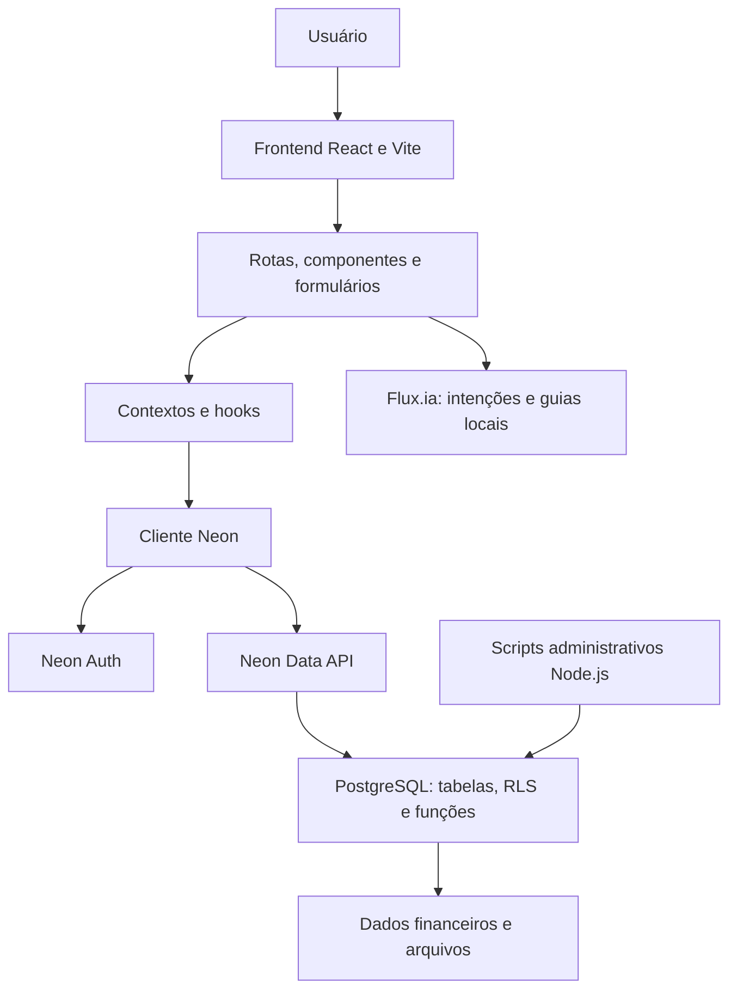
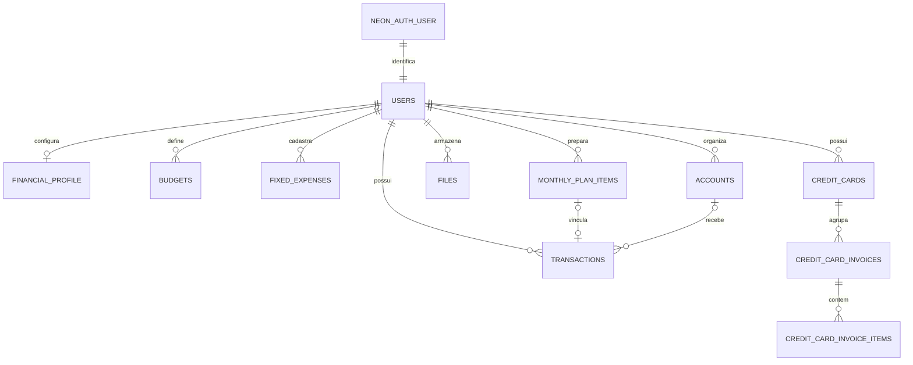
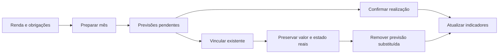
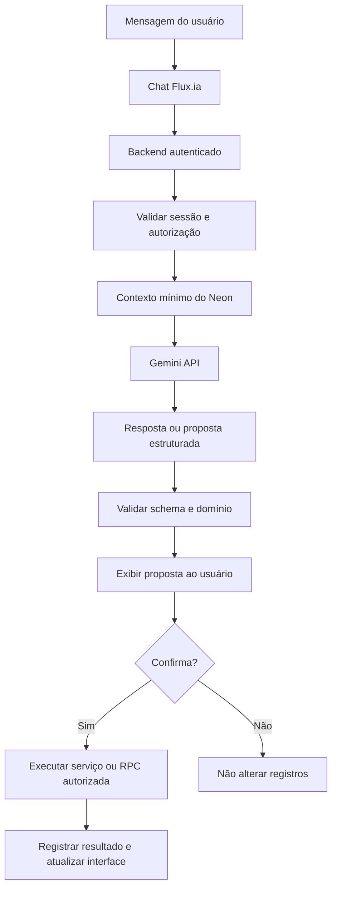

# Fluxo — documentação completa e base técnica para TCC

**Data de referência:** 13 de outubro de 2026.  
**Versão declarada:** 0.0.1.  
**Repositório:** https://github.com/Brun05ouza/fluxo  
**Branch desta entrega:** `codex/migrate-neon`.  
**Commit de referência do código:** `6154d17`.

> Este documento descreve a implementação existente e a evolução proposta. A integração generativa com Google Gemini é um requisito futuro do Flux.ia, e ainda não está implementada. O texto serve como base para o TCC; autoria, formatação acadêmica, referências e resultados de pesquisa devem ser adequados às exigências da instituição.

## Sumário

1. [Apresentação, problema e objetivos](#1-apresentação-problema-e-objetivos)
2. [Estado das funcionalidades](#2-estado-das-funcionalidades)
3. [Tecnologias](#3-tecnologias)
4. [Arquitetura](#4-arquitetura)
5. [Organização do código](#5-organização-do-código)
6. [Modelo de dados](#6-modelo-de-dados)
7. [Regras financeiras](#7-regras-financeiras)
8. [Planejamento mensal](#8-planejamento-mensal)
9. [Autenticação e segurança](#9-autenticação-e-segurança)
10. [Interfaces e rotas](#10-interfaces-e-rotas)
11. [Manual do usuário](#11-manual-do-usuário)
12. [Importação](#12-importação)
13. [Fluxia atual](#13-fluxia-atual)
14. [Evolução do chat com Gemini](#14-evolução-do-chat-com-gemini)
15. [Instalação e execução](#15-instalação-e-execução)
16. [Banco e infraestrutura](#16-banco-e-infraestrutura)
17. [Publicação e manutenção](#17-publicação-e-manutenção)
18. [Testes e evidências](#18-testes-e-evidências)
19. [Requisitos e casos de uso](#19-requisitos-e-casos-de-uso)
20. [Limitações e melhorias](#20-limitações-e-melhorias)
21. [Base para o relatório de TCC](#21-base-para-o-relatório-de-tcc)
22. [Glossário e referências](#22-glossário-e-referências)

## 1. Apresentação, problema e objetivos

### 1.1 Visão geral

O Fluxo é uma aplicação web de gestão financeira pessoal. Reúne receitas, despesas, contas fixas, limites por categoria, contas financeiras e informações de renda. O propósito é permitir que o usuário acompanhe o que foi realizado e o que está previsto para cada mês.

A interface é uma **Single Page Application (SPA)** construída com React e TypeScript. A autenticação e a persistência utilizam Neon Auth, Neon Data API e PostgreSQL. O projeto oferece ainda o assistente visual Flux.ia, que orienta a navegação e deverá evoluir para um chat contextual baseado no Google Gemini.

O sistema conecta a configuração inicial à operação cotidiana: salário líquido e contas mensais podem gerar previsões, posteriormente confirmadas ou associadas a movimentações reais. Isso evita tratar um valor informado no perfil como dinheiro automaticamente recebido.

### 1.2 Público-alvo

Pessoas que desejam organizar orçamento doméstico, salário e outras rendas, controlar obrigações recorrentes e compreender hábitos de consumo. Os guias também procuram apoiar quem possui pouca familiaridade com ferramentas financeiras.

### 1.3 Problema

Informações financeiras frequentemente ficam dispersas entre extratos, anotações e memória. Outra dificuldade é distinguir dinheiro previsto de dinheiro recebido. Também podem existir registros duplicados quando uma previsão é criada manualmente e a movimentação real aparece depois em um extrato importado.

A proposta do Fluxo é centralizar esses dados e estabelecer regras explícitas para previsão, realização e reconciliação. O projeto tem relevância acadêmica por combinar engenharia de software, modelagem relacional, regras de domínio, experiência do usuário e uma proposta de assistência contextual por IA.

### 1.4 Objetivo geral

Desenvolver e avaliar uma aplicação web de gestão financeira pessoal que conecte planejamento mensal e movimentações realizadas, com orientação contextual e evolução prevista para um assistente baseado no Google Gemini.

### 1.5 Objetivos específicos

- Disponibilizar autenticação, recuperação de acesso e configuração financeira inicial.
- Registrar e consultar movimentações, categorias e estados de quitação.
- Filtrar transações por mês, dia, tipo, categoria e texto.
- Gerar previsões a partir da renda líquida e de contas fixas cadastradas.
- Evitar repetição da mesma previsão mensal e permitir vínculo com lançamentos existentes.
- Acompanhar orçamento, gastos e projeções.
- Importar extratos com revisão antes da gravação.
- Isolar dados de diferentes usuários no banco.
- Orientar o uso por chat e guias interativos.
- Projetar Gemini para interpretar perguntas, explicar indicadores e propor ajustes confirmáveis.
- Validar regras e persistência por testes.

### 1.6 Delimitação

O Fluxo registra e organiza dados financeiros. Marcar uma conta como paga não executa pagamento bancário. Cadastrar uma conta não abre conta em uma instituição. O projeto não realiza operações financeiras reais nem possui integração operacional com Open Finance.

## 2. Estado das funcionalidades

| Área | Estado observado | Observação |
| --- | --- | --- |
| Login e senha | Implementados | Neon Auth. |
| Google OAuth | Interface e chamada implementadas | Configuração e consentimento do provedor precisam de validação. |
| Recuperação por código | Frontend implementado | Entrega real de e-mail deve ser validada com a conta do usuário. |
| Onboarding | Implementado | Renda líquida, extras, obrigações, limites e datas. |
| Transações | Implementadas | Cadastro, edição, exclusão, duplicação, quitação e anexos. |
| Calendário | Implementado | Filtro por dia e retorno ao mês completo. |
| Contas fixas | Implementadas | Modelos mensais de obrigações. |
| Orçamentos | Implementados | Limites por categoria, realizado mensal e pendentes. |
| Preparar mês | Implementado | Previsões ligadas à origem e competência; idempotência. |
| Vincular existente | Implementado | Reconcilia previsão pendente e registro real. |
| Contas/carteiras | Implementadas | Tipos, saldo inicial e associação a transações. |
| Cartões e faturas | Estruturas e lógica existentes | Não equivalem a um módulo completo validado de ponta a ponta. |
| Relatórios, score e missões | Implementados | Indicadores calculados por código; parte da jornada é local. |
| Importação CSV | Implementada | Pipeline ativo com prévia e marcação de duplicatas. |
| Importação OFX | Parcial | Existe parser; pipeline ativo ainda rejeita arquivos não CSV. |
| Flux.ia com regras | Implementado | Roteador de intenções e guias. |
| Flux.ia com Gemini | Planejado | Ainda não existe chamada à API Gemini. |
| Integração bancária | Não implementada | Dados informados/importados pelo usuário. |

## 3. Tecnologias

Versões refletem `package.json`. O prefixo `^` admite atualizações segundo o gerenciador; `package-lock.json` fixa a resolução instalada.

| Tecnologia | Versão declarada | Responsabilidade |
| --- | --- | --- |
| React / React DOM | 18.3.1 | Componentes e renderização. |
| TypeScript | ^7.0.2 | Tipagem e contratos. |
| Vite | 6.3.5 | Desenvolvimento e build. |
| React Router DOM | ^7.13.0 | Rotas da SPA. |
| Tailwind CSS | 4.1.12 | Estilos e responsividade. |
| Radix UI | Diversas versões 1.x/2.x | Primitivos de diálogos, menus e seleção. |
| Motion | 12.23.24 | Animações. |
| Lucide React | 0.487.0 | Ícones. |
| Recharts | 2.15.2 | Gráficos. |
| date-fns | 3.6.0 | Datas e localização. |
| React Day Picker | 8.10.1 | Calendário. |
| Sonner | 2.0.3 | Feedback ao usuário. |
| React Hook Form | 7.55.0 | Recursos de formulário disponíveis no projeto. |
| Zod | ^4.3.6 | Validação estruturada. |
| Neon JavaScript SDK | ^0.8.0-beta | Auth e Data API. |
| Better Auth | 1.6.22 | Dependência local, inclusive de utilitários administrativos. |
| node-postgres (`pg`) | ^8.16.3 | PostgreSQL nos scripts de manutenção. |
| Vitest | ^4.0.18 | Testes automatizados. |
| Neon Config / Env | ^1.9.1 / ^1.6.1 | Declaração de infraestrutura e ambiente. |
| PostgreSQL no Neon | 18 no projeto configurado | Banco relacional. |

A versão do serviço de autenticação gerenciado é controlada pelo fornecedor; não deve ser inferida apenas da versão local de `better-auth`.

## 4. Arquitetura

### 4.1 Visão geral



A conexão PostgreSQL com credencial administrativa é usada em scripts, e não pelo navegador. O frontend utiliza URLs públicas de serviços e a identidade autenticada.

### 4.2 Camadas

**Apresentação:** telas React, formulário de transação, gráficos, calendário e assistente visual.

**Estado/acesso:** contextos de autenticação, transações e contas; hooks de perfil, orçamentos e obrigações.

**Aplicação:** serviços que normalizam comandos e validam operações, como transferência.

**Domínio:** contratos de transação, classificação de estado e cálculo de saldo/projeção.

**Infraestrutura:** cliente Neon, repositório de cartões, arquivos, migrations e scripts.

**Banco:** integridade referencial, privilégios, RLS e operações transacionais de planejamento.

A separação é progressiva: o módulo financeiro possui organização em camadas, mas vários hooks ainda acessam diretamente a Data API. Não apresentar o projeto como uma arquitetura limpa integralmente concluída.

### 4.3 Fluxo de gravação

1. O usuário preenche um formulário.
2. O código valida/normaliza os campos.
3. O serviço de comando monta o registro.
4. O SDK envia a solicitação autenticada.
5. A Data API aplica os privilégios e a RLS no PostgreSQL.
6. O banco persiste os dados permitidos.
7. A interface atualiza a consulta e apresenta feedback.

### 4.4 Sincronização

`data-sync.ts` notifica gravações locais, usa `BroadcastChannel` entre abas e atualiza consultas ao retornar à janela. Também consulta a cada 30 segundos enquanto a página está visível. Esse mecanismo não é uma assinatura WebSocket de eventos PostgreSQL.

## 5. Organização do código

```text
fluxo/
├── src/
│   ├── app/
│   │   ├── App.tsx                       # Providers e rotas
│   │   ├── components/
│   │   │   ├── MonthlyPlan.tsx           # Planejamento mensal
│   │   │   ├── Transactions.tsx          # Calendário e movimentações
│   │   │   ├── FirstAccessOnboarding.tsx # Configuração inicial
│   │   │   ├── AuthCodeForm.tsx          # Confirmação/recuperação
│   │   │   ├── ui/                       # Primitivos de interface
│   │   │   └── patterns/                 # Estados vazios e padrões
│   │   └── pages/                        # Orçamentos, perfil e outras telas
│   ├── contexts/                        # Autenticação
│   ├── hooks/                           # Consultas e estado
│   ├── features/
│   │   ├── finance/
│   │   │   ├── domain/                   # Contratos e saldos
│   │   │   ├── application/              # Comandos e casos de uso
│   │   │   └── infrastructure/           # Repositório de cartões
│   │   └── importer/                     # Parsing, normalização e prévia
│   ├── fluxia/
│   │   ├── assistant/                    # Tipos e intenções
│   │   ├── tour/                         # Guias e playbooks
│   │   └── ui/                           # Botão e conversa
│   ├── admin/                            # Administração
│   ├── lib/                              # Cliente, cálculos e utilitários
│   ├── types/                            # Entidades
│   ├── content/                          # Textos da interface
│   └── styles/                           # Tema e estilos
├── neon/migrations/                      # SQL versionado
├── scripts/                              # Administração e testes de integração
├── public/                               # Recursos estáticos
├── docs/                                 # Documentos históricos
├── neon.ts                               # Serviços Neon
├── .env.example                          # Modelo sem credenciais
├── package.json / package-lock.json
├── vite.config.ts / tsconfig.json
├── vercel.json                           # Rotas SPA na hospedagem
└── README.md                             # Instruções resumidas
```

`.env.local`, `.env.*.local`, `.neon` e `.migration-backup/` são ignorados pelo Git. Backups podem conter dados privados e não devem integrar a publicação acadêmica.

## 6. Modelo de dados

### 6.1 Entidades

| Entidade | Finalidade | Campos relevantes |
| --- | --- | --- |
| `neon_auth.user` | Identidade gerenciada | ID, nome, e-mail, verificação e datas. |
| `users` | Perfil da aplicação | ID, nome, CPF, e-mail, avatar e datas. |
| `financial_profile` | Configuração financeira | Renda mensal, dia de recebimento, onboarding e acesso administrativo. |
| `transactions` | Movimentações/previsões | Dono, título, categoria, valor, datas, tipo, origem, estado e vínculos. |
| `budgets` | Limites por categoria | Dono, categoria e limite; unicidade por dono/categoria. |
| `fixed_expenses` | Modelos de obrigação | Título, valor estimado, vencimento, categoria e atividade. |
| `accounts` | Contas/carteiras | Nome, instituição, tipo, saldo inicial, limite e inclusão no total. |
| `credit_cards` | Cartões | Limite, fechamento, vencimento e conta de pagamento. |
| `credit_card_invoices` | Faturas | Competência, total, pago, situação e datas. |
| `credit_card_invoice_items` | Itens de fatura | Compra, valor, parcelas e vínculos. |
| `files` | Avatares/anexos | Dono, tipo, nome, MIME type e conteúdo Base64. |
| `monthly_plan_items` | Origem mensal e sua movimentação | Dono, mês, chave da origem e transação. |
| `fluxo_internal.migrations` | Histórico técnico | Nome, checksum e data de aplicação. |
| `fluxo_internal.imports` | Importação inicial | Identificador e manifesto do backup. |

Identidade e sessões pertencem ao schema `neon_auth`; dados da aplicação, a `public`; controles administrativos, a `fluxo_internal`.

### 6.2 Relações simplificadas



Nomes do diagrama são conceituais. Um item mensal pode ficar sem transação após a exclusão da previsão, mantendo sua identidade para não reaparecer na repetição do botão.

### 6.3 Dinheiro e datas

Valores são persistidos em `NUMERIC/DECIMAL`. A formatação em reais é responsabilidade da interface. Cálculos no navegador usam números JavaScript, cuja precisão/arredondamento merece avaliação futura.

- `date`: data do lançamento ou vencimento.
- `competency_date`: referência de competência; previsões mensais usam o primeiro dia do mês.
- `effective_date`: data efetiva registrada na confirmação.
- `created_at`/`updated_at`: timestamps de controle, quando presentes.

O filtro diário usa chave local `YYYY-MM-DD`, sem converter a escolha do calendário para UTC.

### 6.4 Persistência local

Categorias personalizadas e parte das missões/continuidade da jornada usam `localStorage`, com chave associada ao usuário. Não possuem a mesma sincronização em nuvem das transações. Mensagens do chat atual estão em estado React, sem tabela de histórico persistente.

## 7. Regras financeiras

### 7.1 Tipos, origens e estados

Tipos: `income`, `expense`, `transfer`, `invoice_payment`, `adjustment`.

Origens: `manual`, `automatic`, `imported`, `recurring`.

Estados: `pending`, `settled`, `ignored`. Também existem flags legadas `is_paid` e `is_ignored`, normalizadas pelos serviços de comando. Realizado exige não estar ignorado, não estar pendente e não ter `is_paid = false`.

Receitas normalmente são positivas; despesas, negativas. Transferência exige origem/destino diferentes e saída negativa na origem. Não é uma transferência bancária executada pelo aplicativo.

### 7.2 Realizado versus previsto

```text
Recebido = soma de receitas realizadas do período
Despesas pagas = soma de despesas realizadas do período
A receber = soma de receitas pendentes do período
A pagar = soma de despesas pendentes do período
Resultado previsto = recebido + a receber - despesas pagas - a pagar
```

O resultado previsto compara receitas e despesas do planejamento; não representa necessariamente o patrimônio ou todo o saldo consolidado com saldos iniciais das contas.

Pendências não alteram saldo real. Confirmar pagamento/recebimento registra a data efetiva. Indicadores de orçamento e saldo de caixa possuem regras distintas e não devem ser confundidos.

### 7.3 Orçamentos

Orçamento é limite, não transação. Cadastrar R$ 300 em Casa não significa gastar R$ 300.

```text
Gasto realizado = despesas realizadas da categoria no mês
Percentual utilizado = gasto realizado / limite × 100
Disponível após previsões = limite - gasto realizado - pendências da categoria
```

Despesas ignoradas, transferências e pagamentos de fatura não consomem orçamento. Excluir pagamento de fatura procura evitar repetir a compra já registrada; o módulo completo de cartões ainda exige validação adicional.

O total restante do resumo é limitado a zero. Disponível após previsões pode ser negativo, sinalizando compromissos acima do limite.

### 7.4 Projeções e hábitos

A projeção usa ritmo de despesas variáveis e compromissos pendentes. Despesas ligadas ao planejamento mensal são separadas para não extrapolar uma conta paga uma vez como gasto diário repetido. É uma estimativa determinística, não uma previsão de aprendizado de máquina.

Faixas de utilização: abaixo de 80%, normal; a partir de 80%, atenção; a partir de 100%, crítico. O projeto também apresenta classificações `ESSENTIAL`, `OPTIONAL` e `EMOTIONAL`, score e missões. São heurísticas do aplicativo, não avaliação bancária de crédito nem instrumentos clínicos. Sua eficácia exige estudo específico.

## 8. Planejamento mensal

### 8.1 Preparar mês

`prepare_financial_month(target_month)` cria previsões pendentes para renda principal, rendas extras do snapshot do onboarding e contas fixas ativas.

A renda configurada é líquida e total. As extras detalhadas são descontadas desse total para obter a principal, evitando somá-las duas vezes. Para cadastros legados sem detalhamento, o total funciona como previsão principal.

As previsões têm origem automática, referência de competência e vencimento/recebimento limitado ao último dia válido do mês.

### 8.2 Idempotência

`monthly_plan_items` possui unicidade por usuário/mês/origem. A função usa transação e trava de concorrência. Repetir o botão não gera a mesma origem novamente.

Excluir uma previsão pode deixar o vínculo mensal sem transação, impedindo sua recriação involuntária. Restaurar dados financeiros remove também os vínculos.

### 8.3 Reconciliação

`link_planned_transaction(plan_id, existing_id)` substitui uma previsão pendente por um lançamento existente. Exige dono, competência mensal e sinal do valor compatíveis; o registro real não pode estar ignorado nem já vinculado. Previsão quitada não pode ser reconciliada por esse fluxo.



### 8.4 Exemplo didático

Configuração: renda total R$ 3.500, extra R$ 500 e conta de luz R$ 100. Preparar mês cria renda principal R$ 3.000, extra R$ 500 e despesa R$ 100, todas pendentes.

Se já existe salário recebido de R$ 2.900, vinculá-lo preserva R$ 2.900 e remove a previsão de R$ 3.000. Não soma ambos. Se a luz real custou R$ 110, editar e confirmar a previsão contabiliza R$ 110 uma vez.

### 8.5 Mudança das configurações

Alterar renda/contas afeta preparações futuras. Previsões já criadas são snapshots e podem ser editadas em Transações. Não são sobrescritas automaticamente.

## 9. Autenticação e segurança

### 9.1 Identidade

`AuthContext.tsx` adapta a sessão Neon ao perfil da interface. Um trigger sincroniza identidade e perfil no banco. Contas migradas preservaram IDs e dados, mas senhas antigas não foram importadas; exigem redefinição.

### 9.2 Autorização

- RLS limita registros financeiros ao proprietário.
- Referências entre entidades também são verificadas quanto ao dono.
- O frontend não pode alterar `is_admin` diretamente.
- Funções administrativas verificam a permissão no banco.
- Funções críticas usam `SECURITY DEFINER`, `search_path` controlado e concessões específicas.
- A identidade das RPCs vem da sessão/claims validados pela Data API.

Esconder botões no frontend não substitui autorização de servidor/banco.

### 9.3 Administração

Há acesso por `Ctrl + Shift + A`, modal de PIN e verificação administrativa. `VITE_ADMIN_PIN` fica no bundle: é uma barreira de interface, não segredo de servidor. O controle efetivo permanece nas verificações do banco. A área consulta usuários/estatísticas e permite operações autorizadas sobre privilégios.

### 9.4 Arquivos

Avatares de até 1 MB e anexos de até 5 MB são armazenados em `files` sob RLS, com formatos permitidos. Referências `neon-file:UUID` são resolvidas autenticadamente para Blob/exibição/download.

Base64 aumenta volume e o banco não substitui armazenamento dedicado em todos os cenários. A opção foi adotada para arquivos pequenos na região configurada, onde Object Storage não estava disponível.

### 9.5 Privacidade

O sistema trata informações pessoais e financeiras. Documentar finalidade, minimização, acesso, retenção e exclusão. RLS, isoladamente, não comprova conformidade completa com a LGPD nem segurança certificada.

Usar dados fictícios/anonimizados no TCC. Não publicar CPF, extratos privados, credenciais ou backups. O futuro envio de contexto ao Gemini deve ser explicado e minimizado.

Não há evidência de criptografia de ponta a ponta controlada pelo usuário para todos os dados financeiros. Não usar essa expressão como resultado técnico sem implementação e avaliação específicas.

## 10. Interfaces e rotas

| Rota | Função |
| --- | --- |
| `/` | Dashboard. |
| `/transactions` | Transações, calendário e planejamento. |
| `/import` | Seleção do extrato. |
| `/import/preview` | Revisão antes de gravar. |
| `/fixed-expenses` | Obrigações e planejamento. |
| `/budgets` | Limites e acompanhamento. |
| `/reports` | Contas, na configuração atual das rotas. |
| `/reports/analise` | Análise/relatórios. |
| `/reports/contas` | Redirecionamento para `/reports`. |
| `/profile` | Perfil e parâmetros financeiros. |
| `/settings` | Preferências/restauração. |
| `/admin` | Administração condicionada à autorização. |

Login e onboarding são exibidos conforme o estado de autenticação/configuração, antes das telas financeiras. A interface tem tema claro/escuro, sidebar, avatar, feedback, diálogos e adaptação a telas menores. Tema fica perto do perfil; sair, no menu do perfil.

## 11. Manual do usuário

### 11.1 Cadastro e entrada

Abrir Criar conta grátis, informar os dados e senha, confirmar e-mail quando exigido pelo serviço, entrar e concluir onboarding. O olho mostra/oculta senha. Google depende da configuração OAuth.

### 11.2 Recuperação

Escolher Esqueceu a senha? ou Recupere seu acesso, informar e-mail, receber código, preencher código/nova senha/confirmação e entrar novamente.

### 11.3 Configuração inicial

Informar renda principal líquida, recebimento, renda extra, valores de moradia/energia e vencimentos. Configurar valores pretendidos de alimentação, reserva e lazer. São criados perfil, modelos de obrigação e limites; isso não confirma recebimentos/pagamentos.

### 11.4 Uso mensal

1. Selecionar o mês.
2. Conferir renda e obrigações.
3. Clicar Preparar mês.
4. Revisar previsões e ajustar valores estimados.
5. Confirmar recebimento/pagamento quando realizado.
6. Caso já exista a movimentação, usar Vincular lançamento existente no menu da previsão.

### 11.5 Movimentações

Em Nova transação, escolher Receita/Despesa e preencher título, valor, data, categoria e campos necessários. É possível editar, duplicar, excluir, anexar arquivo e alterar quitação.

A recorrência do formulário materializa datas futuras. É um mecanismo distinto da preparação mensal, que utiliza fontes cadastradas e vínculos próprios.

### 11.6 Filtro de um dia

Na tela Transações, clicar no seletor com calendário, escolher o dia e consultar a tabela. Ver mês inteiro retira o recorte diário. Busca, tipo e categoria continuam combinados. Resumo mensal e filtro diário da tabela são conceitos distintos.

### 11.7 Contas fixas e orçamento

Cadastrar a obrigação com título, valor estimado, vencimento e categoria. Preparar o mês gera sua previsão. Criar o modelo não equivale a pagar.

Criar limites por categoria e acompanhar realizado/pendente. Energia pode ser uma conta fixa da categoria Casa e consumir seu limite quando paga. Limite e previsão não são duas despesas.

### 11.8 Contas, perfil e relatórios

Cadastrar carteiras com saldo inicial/tipo e associar movimentações quando necessário. Revisar a renda e o dia de recebimento no perfil. Consultar gráficos e indicadores no período escolhido.

### 11.9 Restauração

Configurações permite apagar dados financeiros e vínculos de planejamento do usuário, preservando identidade e permissão administrativa. Não equivale a excluir a conta de autenticação.

## 12. Importação

```text
CSV → parsing → normalização → sugestão de categoria
    → consulta por intervalo → marcação de possíveis duplicatas
    → prévia → confirmação → gravação
```

Datas, descrições e valores são normalizados. Duplicatas são comparadas por data, valor e descrição normalizada: são candidatos, não uma garantia universal. O usuário revisa a prévia antes de confirmar.

**Limitação confirmada:** existe parser OFX e a interface/assistente mencionam CSV ou OFX, mas `runImportPipeline` aceita somente `.csv`. Para o TCC, apresentar CSV como fluxo ativo e OFX como integração pendente. Importar extrato não representa conexão automática com uma instituição financeira.

## 13. Flux.ia atual

O assistente possui botão flutuante, painel de conversa, ações rápidas e guias. `intentRouter.ts` detecta palavras-chave/expressões. `FluxiaDrawer.tsx` monta a resposta e usa temporizador para apresentação; intenções com guia abrem a página e iniciam um playbook.

Exemplos: importar extrato, criar orçamento, registrar transação, ver relatórios e entender score.

Esse comportamento é determinístico e baseado em regras. Avatar, chat e indicador de digitação não significam execução de modelo generativo. Não há SDK ou chamada Gemini no fluxo atual inspecionado.

## 14. Evolução do chat com Gemini

### 14.1 Direção definida

**O chat Flux.ia deverá utilizar IA da família Google Gemini para ajudar no uso do Fluxo e propor ajustes contextualizados no planejamento financeiro.** Considerará tela, período, configuração e dados financeiros autorizados. Regras de cálculo e autorização continuarão no sistema.

A finalidade é compreender perguntas livres, explicar indicadores e reduzir dificuldades de navegação. “Ajustar no uso” significa orientar e propor ações de configuração/operação. Alterações persistentes devem ter escopo claro, validação e confirmação.

Essa seção é uma especificação futura, não uma integração já entregue.

### 14.2 Capacidades propostas

- Explicar registro, importação, filtros e reconciliação.
- Distinguir salário configurado, previsto e recebido.
- Explicar utilização e pendências de categorias.
- Sugerir limites compatíveis com renda/compromissos.
- Identificar candidatos a vínculo de previsão e lançamento.
- Propor categorização mostrando registros afetados.
- Resumir gastos usando números calculados pelo sistema.
- Abrir telas/guias contextualizados.

O assistente não deve executar pagamentos, promover privilégios, acessar terceiros ou gravar silenciosamente.

### 14.3 Arquitetura proposta



O backend ainda precisa ser criado, por exemplo no provedor de hospedagem. A escolha deve considerar região e disponibilidade reais. A documentação Gemini descreve function calling e saídas estruturadas que podem apoiar propostas de ações; autorizar e executar permanece responsabilidade da aplicação. Fontes: https://ai.google.dev/gemini-api/docs/function-calling e https://ai.google.dev/gemini-api/docs/structured-output.

### 14.4 Contexto e ferramentas

Enviar apenas o necessário à pergunta: tela, período, resumo por categoria, limites e compromissos relevantes. CPF, credenciais, arquivos completos e registros de outros usuários não são contexto padrão. O backend deve derivar o usuário da sessão; um ID recebido do navegador não autoriza acesso a terceiros.

| Ferramenta conceitual | Responsabilidade proposta |
| --- | --- |
| `consultar_resumo_mensal` | Retornar números calculados/autorizados. |
| `listar_transacoes` | Consultar intervalo limitado do próprio usuário. |
| `explicar_orcamento` | Relacionar limite, realizado e pendente. |
| `propor_alteracao_orcamento` | Exibir anterior/novo para confirmação. |
| `propor_categoria` | Sugerir, sem gravação automática. |
| `propor_vinculo_previsao` | Mostrar previsão e candidato real. |
| `abrir_guia` | Aproveitar os tours existentes. |

Esses nomes ainda não são endpoints implementados.

### 14.5 Exemplo futuro

“Minha conta de luz veio no extrato. Por que ainda aparece a previsão?” O assistente consulta os dados autorizados, mostra candidatos com valor/data/categoria e propõe um vínculo. Após confirmação, o backend executa a regra existente e explica o resultado. Gemini não recebe execução de SQL livre.

### 14.6 Configuração futura

```dotenv
# Variáveis propostas para backend futuro; ainda não usadas pelo app.
GEMINI_API_KEY=
GEMINI_MODEL=
```

Chave apenas no servidor. Não usar `VITE_GEMINI_API_KEY`, que pode entrar no bundle. Selecionar o modelo na implementação conforme disponibilidade, custo, latência e suporte aos contratos.

### 14.7 Segurança e avaliação

Validar schemas, limitar mensagens/contexto/requisições, controlar custos e lidar com indisponibilidade. Descrições de transações/arquivos são dados, não instruções. IA não deve inventar saldos; cálculos devem vir do código. Manter confirmação e rastreabilidade, além dos guias determinísticos como contingência.

Avaliação futura: compreensão de intenção, correção factual dos números, conclusão de tarefas, latência, custo e propostas inadequadas. Essas métricas ainda não foram coletadas como estudo Gemini.

## 15. Instalação e execução

### 15.1 Pré-requisitos

Git, Node.js, npm, projeto Neon e acesso apropriado. Scripts usam `--env-file`; o ambiente utilizado foi Node.js 24. Credenciais administrativas são necessárias apenas às tarefas correspondentes.

```powershell
git clone https://github.com/Brun05ouza/fluxo.git
cd fluxo
git switch codex/migrate-neon
npm ci
```

Após merge, utilizar a branch oficial adotada. A branch citada corresponde à revisão documentada.

### 15.2 Serviços Neon

```powershell
npm i -g neon@latest
neon login
neon init -y --org-id SEU_ORG_ID --project-id SEU_PROJECT_ID --branch production --services 'postgres,auth,data-api'
neon deploy
npm run neon:env
```

Se o projeto já está vinculado, preservar `.neon` e `neon.ts`; evitar reinicialização desnecessária. Login requer autenticação do proprietário. Aspas nos serviços evitam interpretação da vírgula pelo PowerShell.

### 15.3 Ambiente

| Variável | Uso | Exposição |
| --- | --- | --- |
| `VITE_NEON_AUTH_URL` | Endpoint Auth | Pública. |
| `VITE_NEON_DATA_API_URL` | Endpoint Data API | Pública. |
| `DATABASE_URL` | Conexão PostgreSQL | Privada. |
| `DATABASE_URL_UNPOOLED` | Conexão direta para scripts | Privada. |
| `NEON_AUTH_BASE_URL` | URL gerenciada Auth | Origem do alias público. |
| `NEON_AUTH_JWKS_URL` | Verificação de tokens | Infraestrutura de autenticação. |
| `NEON_DATA_API_URL` | URL gerenciada Data API | Origem do alias público. |
| `VITE_ADMIN_PIN` | PIN de interface opcional | Público no bundle; não é segredo. |

`neon deploy` grava `.env.local`; `sync-neon-env.mjs` cria os aliases do Vite. `.env.example` contém placeholders. Nunca versionar credenciais.

### 15.4 Schema e execução

```powershell
npm run db:migrate
neon data-api refresh-schema --database neondb
npm run dev
```

Abrir a URL informada pelo Vite, normalmente porta 5173. A importação administrativa de dados antigos não faz parte de uma instalação comum.

### 15.5 Comandos

```powershell
npm run build
npm test
npm run test:watch
npx tsc --noEmit
```

Build gera `dist/`. Análise de tipos é separada; Vite não substitui toda a análise estática.

## 16. Banco e infraestrutura

### 16.1 Migrations

| Arquivo | Papel |
| --- | --- |
| `001_identity.sql` | Perfil/sincronização de identidade. |
| `002_finance.sql` | Tabelas e campos financeiros. |
| `003_security_and_files.sql` | RLS, arquivos, referências e RPCs. |
| `004_profile_upsert.sql` | Privilégios para upsert sob RLS. |
| `005_monthly_planning.sql` | Planejamento e reconciliação. |
| `006_rpc_identity.sql` | Resolução de identidade nas RPCs. |

`migrate.mjs` aplica arquivos ordenados, checksums e transação. Não editar migration já aplicada: criar nova. Usar conexão direta, sem `-pooler`.

### 16.2 Infraestrutura como código

`neon.ts` declara Auth e Data API e política de expiração de novas branches não padrão. PostgreSQL pertence ao projeto Neon. A região configurada é São Paulo. Identificadores reais e credenciais não são necessários aos exemplos acadêmicos.

### 16.3 Migração anterior

A integração Supabase foi retirada do runtime, credenciais fixas removidas e SDK direto substituído. Scripts de exportação/importação administrativa foram preservados.

Houve backup local, validação em branch isolada, importação transacional, conferência de contagens, preservação de IDs e verificação de arquivo byte a byte. O backup usado tinha 3 usuários, 4 transações, 7 orçamentos, 2 contas fixas e 1 arquivo. Esses números descrevem aquela migração, não uma amostra de pesquisa.

O banco de origem permaneceu para recuperação. Senhas exigiram redefinição. Credenciais/backups ficaram fora do Git.

### 16.4 Funções críticas

| Função | Responsabilidade |
| --- | --- |
| `prepare_financial_month` | Criar previsões idempotentes. |
| `link_planned_transaction` | Vincular previsão e realizado. |
| `restore_financial_data` | Restaurar dados financeiros em transação. |
| `admin_get_users` | Consultar usuários/estatísticas autorizadamente. |
| `admin_set_user_admin` | Alterar privilégio após verificação. |
| `session_user_id` | Resolver identidade das RPCs. |

## 17. Publicação e manutenção

Frontend pode ser hospedado em serviço de arquivos estáticos como Vercel. `vercel.json` reescreve rotas para `index.html`, permitindo abrir URLs da SPA diretamente.

1. Publicar a revisão escolhida.
2. Configurar build `npm run build`, saída `dist` e URLs públicas Neon.
3. Aplicar schema/privilégios separadamente.
4. Registrar domínio no Auth e configurar OAuth.
5. Verificar login, recarregamento de rotas, dados, arquivos e recuperação.

Publicar frontend não aplica migrations automaticamente. Backend Gemini futuro precisará de runtime de servidor, segredo e roteamento não capturado pela reescrita da SPA.

Manutenção inclui backups, atualização de dependências, testes em branches, observação de falhas e revisão de custos. Não executar operações administrativas sem verificar destino e dados afetados.

## 18. Testes e evidências

### 18.1 Unitários

Última validação: 12 testes em dois arquivos. `forecast.test.ts` tem oito testes de projeção/alerta. `financial-status.test.ts` tem quatro testes de estados, exclusões, período e contas mensais.

```text
Test Files  2 passed (2)
Tests       12 passed (12)
```

### 18.2 Integração

`verify-neon.mjs` verifica cadastro, login, sessão, acesso anônimo, isolamento, CRUD, escalada administrativa, arquivos e logout.

`verify-monthly-plan.mjs` verifica salário/extra/conta, idempotência, fevereiro, vínculo com valor real, exclusão e restauração.

```powershell
node --env-file=.env.local scripts/verify-neon.mjs
node --env-file=.env.local scripts/verify-monthly-plan.mjs
```

Os scripts escrevem dados de teste e removem contas temporárias. Preferir branch de validação. Dados reais não são material descartável de teste.

### 18.3 Build e verificação visual

Último build da etapa registrada: `✓ built in 21.92s`; `npx tsc --noEmit` passou. Houve avisos de tamanho do bundle/comentários de dependências, sem impedir build.

Verificações visuais incluíram login temporário, orçamento, calendário, retorno ao mês, visibilidade da senha, tema e painel mensal. Para o TCC, produzir figuras com dados fictícios, legenda, data e revisão do código.

### 18.4 Limites da evidência

Não comprovam ausência de defeitos, eficácia comportamental, conformidade legal, escala ou qualidade Gemini. Entrega real de e-mail, consentimento Google, navegadores variados e cenários completos de cartões precisam de validação complementar.

## 19. Requisitos e casos de uso

### 19.1 Funcionais

| ID | Requisito | Estado |
| --- | --- | --- |
| RF01 | Autenticar/recuperar acesso. | Implementado; serviços externos a validar. |
| RF02 | Configurar renda líquida/datas. | Implementado. |
| RF03 | Manter transações/quitação. | Implementado. |
| RF04 | Filtrar mês/dia. | Implementado. |
| RF05 | Manter contas fixas. | Implementado. |
| RF06 | Acompanhar limites. | Implementado. |
| RF07 | Preparar previsões sem repetição. | Implementado. |
| RF08 | Reconciliar com existente. | Implementado. |
| RF09 | Importar CSV com revisão. | Implementado. |
| RF10 | Manter contas/indicadores. | Implementado. |
| RF11 | Armazenar arquivos por dono. | Implementado. |
| RF12 | Orientar com chat/guias. | Implementado por regras. |
| RF13 | Gemini contextual e propostas confirmadas. | Planejado. |

### 19.2 Não funcionais

| ID | Requisito | Evidência ou trabalho necessário |
| --- | --- | --- |
| RNF01 | Isolamento por usuário. | RLS/testes. |
| RNF02 | Integridade no planejamento. | Transações/unicidade/testes. |
| RNF03 | Uso em diferentes telas. | Layout responsivo; avaliação formal pendente. |
| RNF04 | Código tipado/build reproduzível. | TypeScript/lockfile/build. |
| RNF05 | Segredos fora do frontend/Git. | Variáveis privadas/ignore; auditoria contínua. |
| RNF06 | Feedback de sucesso/erro. | Mensagens/estados. |
| RNF07 | Schema versionado. | Migrations/checksums. |
| RNF08 | Controle de ações/custo de IA. | Planejado. |

### 19.3 Casos de uso

**Preparar mês:** usuário autenticado com perfil configurado seleciona o período, prepara previsões e revisa. Pós-condição: origens previstas representadas uma vez. Exceções: perfil ausente, conexão indisponível ou repetição sem novos itens.

**Reconciliar salário:** usuário seleciona previsão pendente e receita real compatível. Pós-condição: valor/status reais preservados e previsão removida. Exceções: outro proprietário, competência incompatível ou vínculo já existente.

**Ajuste futuro com Gemini:** usuário pergunta, backend obtém contexto autorizado, modelo propõe, interface exibe alterações, usuário confirma e serviço executa. Exceções: indisponibilidade, proposta inválida, falta de autorização ou recusa.

## 20. Limitações e melhorias

1. Gemini precisa de backend, credenciais, contratos e avaliação.
2. Integrar OFX ao pipeline ativo e alinhar textos ao suporte real.
3. Migrar categorias/jornada local para nuvem se necessário entre dispositivos.
4. Ampliar testes de cartões/faturas e revisar atomicidade de seu pagamento.
5. Estudar aritmética decimal/centavos e política de arredondamento no frontend.
6. Uniformizar todos os relatórios quanto a competência, vencimento e data efetiva.
7. Validar projeções para meses anteriores/futuros e renda variável.
8. Avaliar armazenamento dedicado de arquivos, custos e região.
9. Auditar dependências, monitoramento, rate limiting, backups e recuperação.
10. Evoluir onboarding para persistência atômica de todas as etapas e edição de fontes de renda.
11. Avaliar teclado, leitores de tela, contraste e telas pequenas sistematicamente.
12. Reduzir bundle por carregamento sob demanda e medir consultas.
13. Adicionar auditoria de alterações financeiras e futuras ações da IA.
14. Melhorar reconciliação/duplicatas sem associações automáticas incorretas.

Essas limitações são parte do diagnóstico técnico; não devem ser omitidas no relatório.

## 21. Base para o relatório de TCC

### 21.1 Título sugerido

**Fluxo: desenvolvimento de uma aplicação web de gestão financeira pessoal com planejamento mensal integrado e proposta de assistência contextual baseada em Gemini.**

Se Gemini for implementado/avaliado antes da entrega, atualizar título e resultados. Enquanto não estiver, manter “proposta”.

### 21.2 Resumo inicial

Este trabalho apresenta o desenvolvimento do Fluxo, uma aplicação web destinada à organização financeira pessoal. A solução utiliza React e TypeScript na interface e PostgreSQL no Neon para persistência e controle de acesso. O sistema reúne transações, contas fixas, limites por categoria, importação de extratos CSV e indicadores financeiros. O planejamento mensal conecta informações de renda e obrigações a previsões pendentes, permitindo confirmar movimentações realizadas e vincular registros já existentes para reduzir duplicações. O projeto inclui o assistente Flux.ia, atualmente baseado em regras e guias interativos, cuja evolução prevê integração com Google Gemini para orientação contextual e proposição de ajustes sujeitos à confirmação. A validação técnica utiliza análise estática, testes unitários e testes de integração. Avaliações de usabilidade e da eficácia do assistente generativo são propostas como etapas posteriores.

**Palavras-chave:** gestão financeira pessoal; aplicação web; PostgreSQL; planejamento mensal; inteligência artificial; Gemini.

### 21.3 Capítulos recomendados

1. Introdução: contexto, problema, objetivos, justificativa e delimitação.
2. Fundamentação: gestão financeira, engenharia de software, SPA, banco relacional, autorização e assistência por IA.
3. Trabalhos relacionados: comparação por critérios/fontes, sem inventar funções de outros produtos.
4. Metodologia: levantamento, modelagem, implementação incremental e avaliação.
5. Desenvolvimento: arquitetura, dados, interface, regras e migração.
6. Assistente: regras atuais e proposta Gemini, ou integração real se concluída.
7. Validação/resultados: testes, cenários, defeitos e limites.
8. Conclusão: objetivos, contribuições, limitações e evolução.

### 21.4 Metodologia

Pode ser caracterizado como pesquisa aplicada com desenvolvimento de artefato de software, conforme orientação do curso. Registrar o processo realmente seguido; não afirmar uma metodologia formal que não foi aplicada.

Para avaliação com usuários, definir participantes, tarefas, métricas, critérios e tratamento ético conforme a instituição. A escrita não deve transformar verificações técnicas em evidência de satisfação ou mudança de comportamento financeiro.

### 21.5 Avaliação proposta

| Questão | Procedimento | Medida |
| --- | --- | --- |
| Diferencia previsto/realizado? | Preparar/confirmar mês fictício. | Acertos/erros de interpretação. |
| Vínculo reduz duplicação? | Receita importada e previsão. | Reconciliação/total final. |
| Calendário facilita consulta? | Localizar data específica. | Tempo/conclusão. |
| Guia melhora navegação? | Tarefas com/sem orientação. | Tempo/conclusão/dificuldades. |
| Gemini respeita contexto? | Perguntas com respostas esperadas. | Correção de intenção/números/propostas. |

Esses estudos ainda não possuem resultados coletados suficientes no repositório. Não inventar participantes, percentuais ou questionários.

### 21.6 Evidências a preservar

Revisão/data do código, saídas dos testes, cenários fictícios, diagramas, capturas sem dados pessoais, decisões e limitações. Se IA for implementada: modelo/configuração, contratos de ferramentas, custos e conjunto de avaliação.

## 22. Glossário e referências

### 22.1 Glossário

| Termo | Significado |
| --- | --- |
| SPA | Navegação executada principalmente no navegador. |
| Hook/Context | Reuso de estado/efeitos e compartilhamento entre componentes. |
| RLS | Restrição de linhas por identidade no PostgreSQL. |
| RPC | Chamada de função exposta pela Data API. |
| Competência | Período de atribuição no planejamento. |
| Data efetiva | Dia do pagamento/recebimento confirmado. |
| Previsão | Movimentação esperada e pendente. |
| Idempotência | Repetir não repete o mesmo efeito registrado. |
| Migration | Mudança versionada de schema/regras. |
| Reconciliação | Associação entre previsão e realizado. |
| Function calling | Proposta de chamada a ferramenta definida pela aplicação. |
| Saída estruturada | Resposta organizada segundo schema validável. |

### 22.2 Fontes primárias do projeto

`README.md`, `package.json`, `src/app/App.tsx`, `AuthContext.tsx`, `MonthlyPlan.tsx`, `Transactions.tsx`, `budgets-page.tsx`, `financial-status.ts`, `transaction-utils.ts`, `forecast.ts`, camadas de `features/finance`, pipeline de `features/importer`, `FluxiaDrawer.tsx`, `intentRouter.ts`, `neon/migrations` e `scripts`.

### 22.3 Documentação oficial

- React: https://react.dev/
- TypeScript: https://www.typescriptlang.org/docs/
- Vite: https://vite.dev/guide/
- PostgreSQL: https://www.postgresql.org/docs/
- Neon Data API: https://neon.com/docs/data-api/overview
- Neon Auth: https://neon.com/docs/auth/overview
- Migração de autenticação: https://neon.com/docs/auth/migrate/from-supabase
- Gemini function calling: https://ai.google.dev/gemini-api/docs/function-calling
- Gemini saídas estruturadas: https://ai.google.dev/gemini-api/docs/structured-output
- Vitest: https://vitest.dev/guide/

**Consulta das páginas Gemini para esta documentação:** 13 de outubro de 2026. Para as demais, registrar a consulta efetiva realizada na escrita acadêmica. Elaborar referências no padrão institucional, conferir autoria/data e complementar com literatura acadêmica pertinente.

As propostas Gemini e de avaliação são decisões de projeto sugeridas, não resultados de pesquisa já executada.
